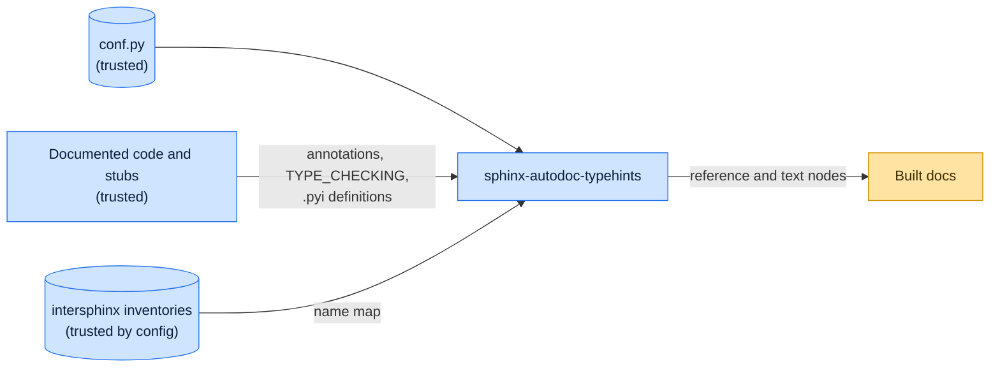

# Threat model

This model says what sphinx-autodoc-typehints trusts, where untrusted input enters, and which guarantees hold at each
boundary, so a report can be classified as a vulnerability or a bug. [SECURITY.md](SECURITY.md) covers reporting; if the
two disagree, SECURITY.md wins and we fix this file.

## How sphinx-autodoc-typehints works

For each object autodoc documents, the extension reads its annotations, resolves forward references, names imported only
under `if TYPE_CHECKING:` and declarations in `.pyi` stubs, and renders each type as cross-references, using the
inventories intersphinx has loaded to map names to documentation. To resolve stub-only names it executes the stub's
class and alias definitions in a scratch namespace, and evaluates `sys.version_info` and `sys.platform` checks with no
builtins but `sys`.

## Compared with similar tools

We drew the boundary where comparable projects in other ecosystems draw theirs. The shared rule, stated by the
[Node.js threat model](https://github.com/nodejs/node/blob/main/SECURITY.md#the-nodejs-threat-model), is that a report
which first needs a trusted element compromised is out of scope; the first triage question, as
[DOMPurify](https://github.com/cure53/DOMPurify/blob/main/SECURITY.md#what-we-consider-a-vulnerability) puts it, is what
the attacker controls.

| Project                                                                              | Language   | Where it draws the line                                                                                             |
| ------------------------------------------------------------------------------------ | ---------- | ------------------------------------------------------------------------------------------------------------------- |
| [Sphinx autodoc](https://www.sphinx-doc.org/en/stable/usage/extensions/autodoc.html) | Python     | Imports the modules it documents and warns that their import-time side effects run; the documented code is trusted. |
| [TypeDoc](https://github.com/TypeStrong/typedoc/security/policy)                     | TypeScript | Documentation generator that loads the project's own compiler setup; patches the latest minor version.              |
| [rustdoc](https://www.rust-lang.org/policies/security)                               | Rust       | Covered by the Rust security policy; documenting a crate builds it, running its build script and macros.            |

## Trusted

An attacker who controls any of these already has what sphinx-autodoc-typehints could give them:

- The Sphinx configuration, including formatter callables.
- The documented package, its stubs and installed dependencies, all of which autodoc imports.
- The intersphinx inventories the configuration lists, which Sphinx fetches.

## Untrusted inputs

| Input                   | Comes from                         | What sphinx-autodoc-typehints guarantees               |
| ----------------------- | ---------------------------------- | ------------------------------------------------------ |
| Stub version conditions | `.pyi` files of installed packages | Evaluated with empty builtins and only `sys` in scope. |

## Threats and controls

| STRIDE                 | Threat                                     | Control                            |
| ---------------------- | ------------------------------------------ | ---------------------------------- |
| Elevation of privilege | A stub's version check calls `__import__`. | No builtins in the eval namespace. |

## Release chain

Releases run on the shared [tox-dev/github-workflows](https://github.com/tox-dev/github-workflows) pipeline. A release
App, not a person, pushes the release commit and tag; the build installs its tools hash-checked from `pylock.toml` with
a seven-day upload cooldown; PyPI receives the files through
[trusted publishing](https://docs.pypi.org/trusted-publishers/) with attestations, and the GitHub Release is immutable.
Every workflow pins third-party actions to a commit SHA.

## Vulnerability or bug

| Report                                                   | Verdict             | Why                                 |
| -------------------------------------------------------- | ------------------- | ----------------------------------- |
| A stub condition `__import__('os').system(...)` runs     | Vulnerability       | The eval namespace must stay empty. |
| Building docs for a package runs its import side effects | Not a vulnerability | autodoc imports documented code.    |
| A type renders without a link                            | Bug                 | Rendering only.                     |

## Accepted risks

- Stub class and alias definitions are executed to resolve names; stubs are part of the trusted installed packages.

## Keeping this current

Revisit this model when sphinx-autodoc-typehints gains a new input source, network access, a new way to run code, or a
new place it writes to, and whenever an advisory is published.
