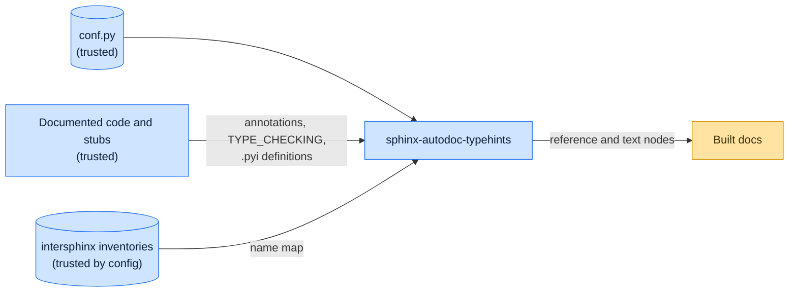

# Threat model

This model says what sphinx-autodoc-typehints trusts, where untrusted input enters, and which guarantees hold at each
boundary, so a report can be classified as a vulnerability or a bug. [SECURITY.md](SECURITY.md) covers reporting; if the
two disagree, SECURITY.md wins and we fix this file.

## How sphinx-autodoc-typehints works

For each object autodoc documents, the extension reads its annotations, evaluates string annotations and forward
references in the object's module namespace, runs `if TYPE_CHECKING:` blocks to resolve names imported only there, and
reads `.pyi` stubs, whose class and alias definitions it executes in a scratch namespace and whose version and platform
`if` conditions it evaluates. It renders each type as cross-references, using the inventories intersphinx has loaded to
map names to documentation.

## Compared with similar tools

We drew the boundary where comparable projects in other ecosystems draw theirs. The shared rule, stated by the
[Node.js threat model](https://github.com/nodejs/node/blob/main/SECURITY.md#the-nodejs-threat-model), is that a report
which first needs a trusted element compromised is out of scope; the first triage question, as
[DOMPurify](https://github.com/cure53/DOMPurify/blob/main/SECURITY.md#what-we-consider-a-vulnerability) puts it, is what
the attacker controls.

| Project                                                                              | Language   | Where it draws the line                                                                                                                               |
| ------------------------------------------------------------------------------------ | ---------- | ----------------------------------------------------------------------------------------------------------------------------------------------------- |
| [Sphinx autodoc](https://www.sphinx-doc.org/en/stable/usage/extensions/autodoc.html) | Python     | Imports the modules it documents and warns that their import-time side effects run; the documented code is trusted.                                   |
| [TypeDoc](https://github.com/TypeStrong/typedoc/security/policy)                     | TypeScript | Documentation generator; patches the latest minor version and accepts community fixes for the one before.                                             |
| [rustdoc](https://www.rust-lang.org/policies/security)                               | Rust       | The Rust toolchain, Cargo included, assumes the user's code and dependencies are trusted; compiling or analyzing a malicious project is out of scope. |

## Trusted

An attacker who controls any of these already has what sphinx-autodoc-typehints could give them:

- The Sphinx configuration, including formatter callables.
- The documented package, its stubs and installed dependencies, all of which autodoc imports.
- The intersphinx inventories the configuration lists, which Sphinx fetches.

## Untrusted inputs

| Input           | Comes from                                                                  | What sphinx-autodoc-typehints guarantees                     |
| --------------- | --------------------------------------------------------------------------- | ------------------------------------------------------------ |
| None of its own | Everything it reads is the documented code, its stubs, or the configuration | It writes no files and makes no network requests of its own. |

## Threats and controls

| STRIDE                 | Threat                                                                         | Control                                               |
| ---------------------- | ------------------------------------------------------------------------------ | ----------------------------------------------------- |
| Elevation of privilege | Building docs runs the documented package's annotations, guards and stub code. | Accepted, as in Sphinx autodoc: that code is trusted. |
| Tampering              | A name resolves to a module outside the documented package and its imports.    | Report any resolution outside those sources.          |

## Release chain

Releases run on the shared [tox-dev/github-workflows](https://github.com/tox-dev/github-workflows) pipeline. A release
App, not a person, pushes the release commit and tag; the build installs its tools from a hash-checked `pylock.toml`
resolved with a seven-day upload cooldown by default; PyPI receives the files through
[trusted publishing](https://docs.pypi.org/trusted-publishers/) with attestations, and the GitHub Release is immutable.
Every workflow pins third-party actions to a commit SHA.

## Vulnerability or bug

| Report                                                   | Verdict             | Why                                               |
| -------------------------------------------------------- | ------------------- | ------------------------------------------------- |
| A stub's `if` condition runs code during the docs build  | Not a vulnerability | Stubs are part of the trusted installed packages. |
| Building docs for a package runs its import side effects | Not a vulnerability | autodoc imports documented code.                  |
| A type renders without a link                            | Bug                 | Rendering only.                                   |

## Severity

- **Medium:** a name resolved from outside the documented package and its imports, or a file written outside the build
  output.
- **Low:** a crash on an unusual annotation instead of a clean build warning.

## Accepted risks

- Building documentation executes the documented package's annotations, `TYPE_CHECKING` blocks and stub code.

## Keeping this current

Revisit this model when sphinx-autodoc-typehints gains a new input source, network access, a new way to run code, or a
new place it writes to, and whenever an advisory is published.
