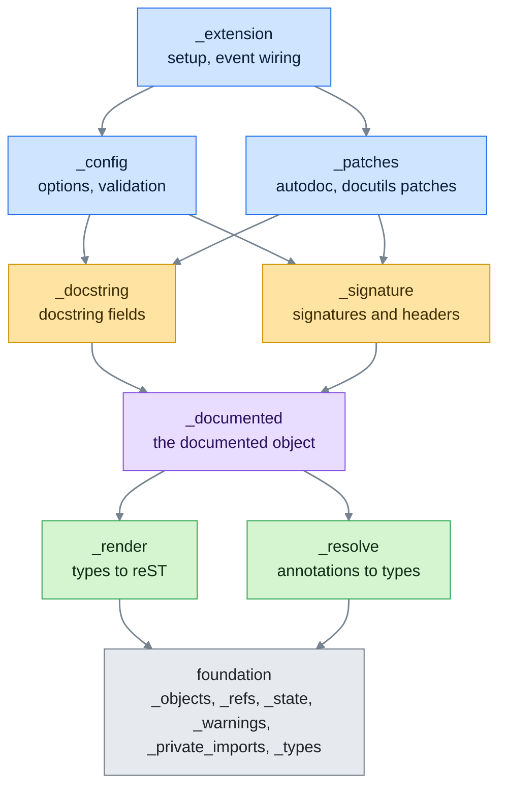
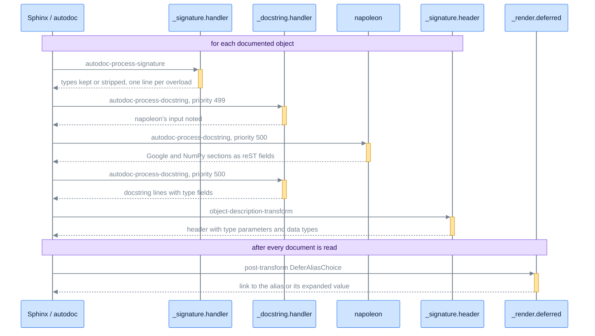
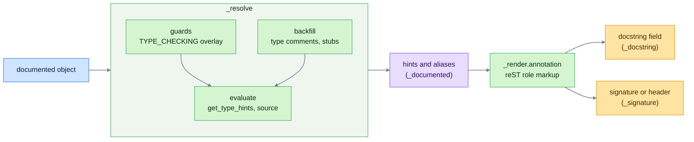

# Contributing to sphinx-autodoc-typehints

This guide covers setting up a development environment, the layout of the extension, and what a pull request needs
before it can merge.

## Code of Conduct

Be respectful and constructive in all interactions. We aim to keep a welcoming environment for every contributor.

## Getting Started

The project runs every development task through [tox](https://tox.wiki). Install it with its uv plugin, then list the
environments:

```bash
uv tool install tox --with tox-uv
tox list
```

## Development Workflow

### Running Tests

Run the suite on one interpreter with `tox r -e 3.14`, or on several with `tox r -e 3.12,3.15`. Each run measures
coverage and fails below 100%, and `diff-cover` holds the lines your branch changes against `origin/main` to 100% too.
Point it at another base with the `DIFF_AGAINST` environment variable, for example `DIFF_AGAINST=upstream/main`.

To run a single test file while you work, use the interpreter tox created:
`.tox/3.14/bin/python -m pytest tests/_render`.

### Code Quality Checks

`tox r -e fix` runs pre-commit, which formats and lints with ruff, formats Markdown with mdformat, and checks the import
layers with import-linter (see [Architecture](#architecture)). `tox r -e type` type checks the package and the tests
with [ty](https://github.com/astral-sh/ty).

### Package Metadata

`tox r -e pkg_meta` builds the sdist and wheel, then checks the long description with twine and the wheel layout with
check-wheel-contents.

### Development Environment

`tox r -e dev` creates `.tox/dev/` with an editable install and every development dependency, for your editor to use.

## Architecture

The extension hooks into Sphinx autodoc. It reads the annotations of each object autodoc documents and writes them into
the signature, the docstring fields and the header of the entry. Everything lives under `src/sphinx_autodoc_typehints/`,
split into layered packages.

### Layers

Each layer imports only from the layers below it. import-linter enforces the order from `pyproject.toml`, so an import
pointing up fails `tox r -e fix`.



Packages on the same level, such as `_render` and `_resolve`, don't import each other. When rendering needs something
from resolution, `_documented` passes it in, for example the guard binder typed by the `GuardBinder` protocol in
`_render/context.py`. Every package `__init__.py` exports through `__all__` only the names another layer imports, and
every module opens with a docstring stating what it owns.

### Folder layout

| Path                  | Responsibility                                                                                                                                                                                                       |
| --------------------- | -------------------------------------------------------------------------------------------------------------------------------------------------------------------------------------------------------------------- |
| `_extension.py`       | `setup`: registers the options, the roles, the directive and the post-transform, connects the event handlers and installs the patches                                                                                |
| `_config.py`          | The configuration options and their validation                                                                                                                                                                       |
| `_patches/`           | Monkeypatches to autodoc and to docutils                                                                                                                                                                             |
| `_docstring/`         | The `autodoc-process-docstring` handler, which writes the fields of parameters, of the return value, of attributes and the rest                                                                                      |
| `_docstring/formats/` | One subpackage per docstring style the extension edits, `field_list` (reST field lists), `napoleon` output and `numpydoc` sections                                                                                   |
| `_signature/`         | The `autodoc-process-signature` handler, and `header/`, which rewrites the overload lines, type parameters and data type of the header Sphinx builds                                                                 |
| `_documented/`        | What the extension works out about the documented object, such as its hints, its overloads, its members and its render scope                                                                                         |
| `_render/`            | Turning types into reST cross-references; `annotation/` walks one annotation, `deferred.py` chooses alias links once every document is read                                                                          |
| `_resolve/`           | Turning annotations into types: `evaluate/` evaluates them, `guards/` runs `if TYPE_CHECKING:` blocks into an overlay, `backfill/` reads type comments and `.pyi` stubs                                              |
| foundation modules    | Helpers every layer may use: `_objects` (unwrapping, owners), `_refs`, `_state` (environment records), `_warnings`, `_private_imports` (every private name read from a dependency or the standard library), `_types` |

Tests mirror this tree, so tests for `src/sphinx_autodoc_typehints/_resolve/guards/run.py` live in
`tests/_resolve/guards/test_run.py`, and `src/sphinx_autodoc_typehints/_config.py` maps to `tests/test__config.py`.
Sphinx projects that tests build live in `tests/roots/`.

### Event flow

Sphinx calls the extension at fixed points of a build. The handlers run in this order for each documented object, and
the deferred alias choice runs once every document is read:



### From annotation to rendered type

A docstring field and a signature line both go through the same resolution and rendering:



## Making Changes

### Fork and Branch

Fork the repository on GitHub, clone your fork, and create a branch from `main` with a descriptive name such as
`fix-overload-headers`.

### Code Style

Follow the patterns in the code around your change. `tox r -e fix` must pass, and all code, tests included, carries type
annotations that `tox r -e type` accepts. A few conventions the linters don't catch:

- Keep functions between 20 and 50 lines, and pull a part into its own function only when two places call it.
- Comments explain why the code does something, not what it does. Private functions carry no docstrings.
- Quote code in comments and docstrings with single backticks.
- Write multi-line strings as triple-quoted `textwrap.dedent` text rather than `"\n"` escapes.
- Every `noqa` or `ty: ignore` names its code and gives the reason inline; a ty gap links the upstream
  [ty issue](https://github.com/astral-sh/ty/issues).

### Testing

Add a test for every bug fix and feature, in the test file that mirrors the module you change. The test must fail
without your change. Test through each package's exported names, parametrize near-duplicate cases with readable ids, and
mock only true boundaries such as the network.

### Documentation

The documentation lives in `docs/` as reStructuredText and publishes to
[Read the Docs](https://sphinx-autodoc-typehints.readthedocs.io). It follows [Diátaxis](https://diataxis.fr): a tutorial
in `tutorials.rst`, task guides in `how-to.rst`, the reference in `reference.rst`, and the explanation in
`concepts.rst`. Update it for any user-visible change, and build it with `tox r -e docs`, which fails on any warning and
prints the path of the built `index.html`.

Show an example through the `live-example` directive from `docs/_ext/live_example.py`. Its content holds the `conf.py`
lines, a `---` line, then the source of a module `demo`. While the docs build, the directive renders that module twice,
once with this extension and once with Sphinx's `autodoc_typehints = "description"` alone, and shows four tabs, the
settings, the source and both rendered pages. Both builds resolve links through the inventories the docs build
downloaded, which the directive writes next to its cache. The directive caches each page under the doctree folder by the
hash of the example, the extension's source and those inventories. An example that fails to build with this extension
fails the docs build; one that fails without it shows Sphinx's warnings in its tab:

```rst
.. live-example::

    # show each type with its module
    typehints_fully_qualified = True
    ---
    def total(prices: list[int]) -> int:
        """Add the prices up."""
        return sum(prices)
```

A `live-example-picker` directive, as `typing.rst` has, makes the examples after it on the page share one `conf.py` and
lists options, one `name = default, other, ...` line each, with `if other_option` at the end for an option that only
matters while another one is on. A `conf.py` button in the corner of each rendered page then opens controls for those
options in place of the `conf.py` tab, and a choice there switches every example on the page. One Sphinx application in
the docs build process renders each example under the combinations of the options that change it, found by rendering it
with up to two options away from their defaults, and the page loads those renderings from `_static/live-examples/` when
the reader picks a combination. `docs/_static/live-example-picker.js` does the switching and keeps the choice in
`localStorage`.

Define a configuration option with `.. confval::` in `reference.rst`, giving its `:default:` and `:rebuild:`, and add
its annotation to `OPTION_TYPES` in `docs/_ext/option_reference.py`; the directive renders the type from it with this
extension, a callable option through the protocol the extension calls it with. `tests/test_docs.py` checks the options,
their types, defaults and rebuild values, the warning categories and the typing constructs table against the code, so a
stale reference fails the suite.

## Submitting Changes

### Commit Messages

Follow Commitizen conventions with a gitmoji, `<emoji> <type>(<scope>): <summary>`, and an optional body explaining the
motivation. For example:

```
🐛 fix(overloads): keep an overload's ... default as written

An overload's default of ... means "has a default", so showing the
implementation's value there contradicted the overload's own annotation.
```

### Pull Requests

Make sure `tox r -e fix,type,docs,3.12,3.15` passes, push to your fork and open a pull request against `main`. Describe
the problem and the change, and show the rendered output before and after where it changed. CI runs every supported
Python version, including the free-threaded builds.

## Getting Help

Check the existing [issues](https://github.com/tox-dev/sphinx-autodoc-typehints/issues) and the
[documentation](https://sphinx-autodoc-typehints.readthedocs.io) before asking, then open an issue for bugs or feature
requests.

## License

By contributing, you agree to release your contributions under the project's MIT License.
