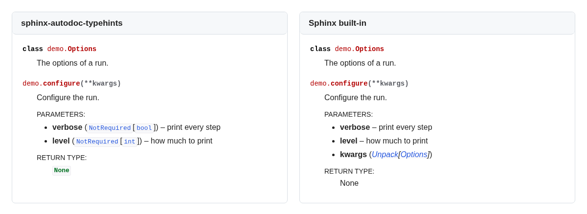

<picture>
  <source media="(prefers-color-scheme: dark)" srcset="https://raw.githubusercontent.com/tox-dev/sphinx-autodoc-typehints/main/docs/_static/logo-horizontal-dark.svg">
  
</picture>

# sphinx-autodoc-typehints

[](https://pypi.org/project/sphinx-autodoc-typehints/)
[](https://pypi.org/project/sphinx-autodoc-typehints/)
[](https://sphinx-autodoc-typehints.readthedocs.io/en/latest/?badge=latest)
[](https://pepy.tech/project/sphinx-autodoc-typehints)
[](https://github.com/tox-dev/sphinx-autodoc-typehints/actions/workflows/check.yaml)

This [Sphinx](https://www.sphinx-doc.org/) extension reads the
[type hints](https://docs.python.org/3/library/typing.html) of the code autodoc documents and writes them into the
parameter and return fields, so you state each type once, in the code. It links every part of a type to its
documentation, and resolves names your code imports only for type checkers (inside an `if TYPE_CHECKING:` block) or
declares in `.pyi` stub files. It also documents `@overload` variants and default values, and types Google and NumPy
style docstrings written for napoleon or numpydoc.

```bash
pip install sphinx-autodoc-typehints
```

```python
# conf.py: load autodoc first, then this extension
extensions = ["sphinx.ext.autodoc", "sphinx_autodoc_typehints"]
```

## Why not Sphinx's built-in `autodoc_typehints`?

Sphinx's
[`autodoc_typehints = "description"`](https://www.sphinx-doc.org/en/master/usage/extensions/autodoc.html#confval-autodoc_typehints)
already moves annotations into the parameter and return fields, links them, and works with napoleon docstrings and type
comments. If your annotations resolve at runtime and you use Sphinx fields or napoleon, that setting may be enough.

The same `demo.py` below renders differently with each option. Both builds use `.. automodule:: demo` with `:members:`;
the left uses the configuration above, while the right loads only `sphinx.ext.autodoc` with
`autodoc_typehints = "description"`.

```python
from typing import TypedDict, Unpack


class Options(TypedDict, total=False):
    """The options of a run."""

    verbose: bool
    level: int


def configure(**kwargs: Unpack[Options]) -> None:
    """
    Configure the run.

    :keyword verbose: print every step
    :keyword level: how much to print
    """
```



The
[live example](https://sphinx-autodoc-typehints.readthedocs.io/en/latest/concepts.html#keyword-arguments-from-a-typeddict)
lets you inspect the rendered text and configuration. Beyond this example, this extension adds:

- [Names imported under `if TYPE_CHECKING:`](https://sphinx-autodoc-typehints.readthedocs.io/en/latest/typing.html#type-checking-imports)
  link to their real module (`decimal.Decimal`, not a bare `Decimal`).
- [Types from `.pyi` stubs](https://sphinx-autodoc-typehints.readthedocs.io/en/latest/how-to.html#pyi-stubs) fill in
  functions that carry no annotations, such as those of a C extension.
- [`**kwargs: Unpack[TypedDict]`](https://sphinx-autodoc-typehints.readthedocs.io/en/latest/typing.html#kwargs-typed-with-unpack)
  gets keyword fields typed from the `TypedDict` entries.
- [numpydoc `Parameters` sections](https://sphinx-autodoc-typehints.readthedocs.io/en/latest/how-to.html#use-with-numpydoc)
  get types in place, rather than in a second list.
- [`@overload` variants](https://sphinx-autodoc-typehints.readthedocs.io/en/latest/typing.html#overload) get an
  `Overloads` field, and
  [default values](https://sphinx-autodoc-typehints.readthedocs.io/en/latest/how-to.html#show-default-values) appear
  next to the types.
- [`@deprecated` notices](https://sphinx-autodoc-typehints.readthedocs.io/en/latest/typing.html#deprecated),
  [`@override` links](https://sphinx-autodoc-typehints.readthedocs.io/en/latest/typing.html#override), and
  [property setter types](https://sphinx-autodoc-typehints.readthedocs.io/en/latest/reference.html#property-setters) add
  details beyond parameter types.

The
[full comparison](https://sphinx-autodoc-typehints.readthedocs.io/en/latest/concepts.html#compared-with-sphinx-s-built-in-type-hints)
lists the differences, and the live examples show each module rendered both ways.

The [typing features gallery](https://sphinx-autodoc-typehints.readthedocs.io/en/latest/typing.html) shows source and
rendered output for each construct. The [documentation](https://sphinx-autodoc-typehints.readthedocs.io/en/latest/) also
has a tutorial, how-to guides and the option reference; [CONTRIBUTING.md](CONTRIBUTING.md) explains how to work on the
extension.
